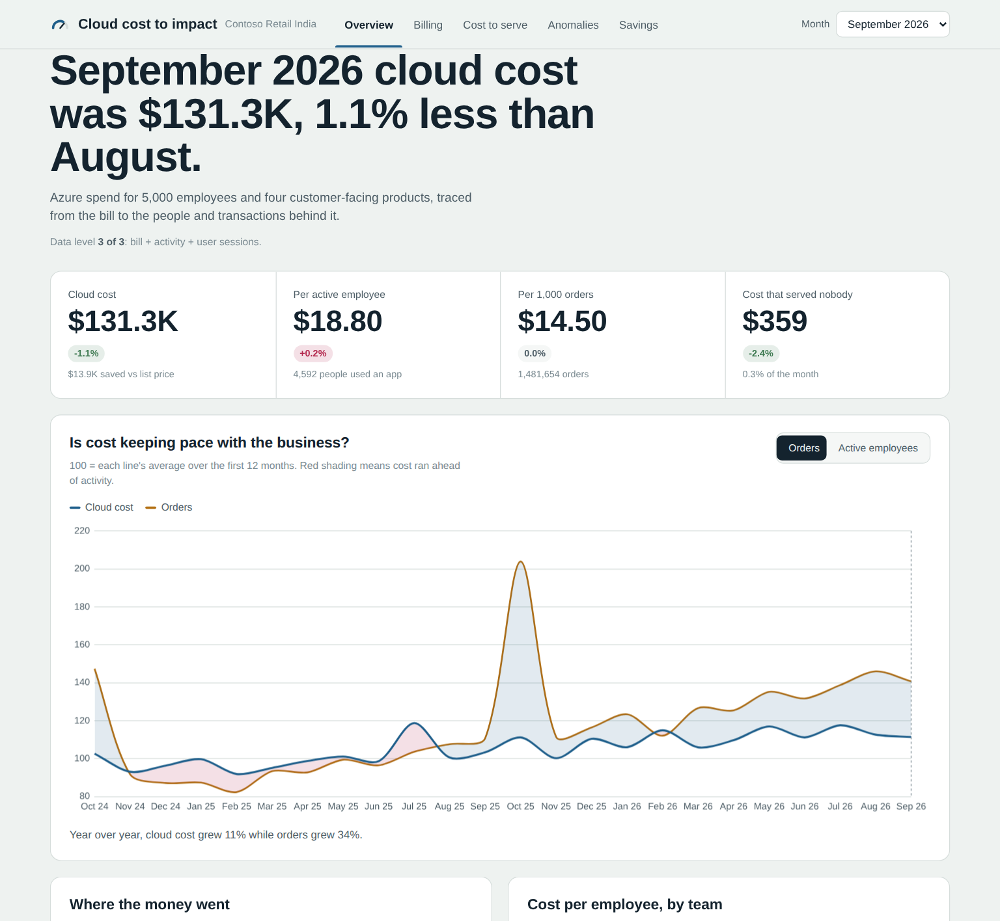
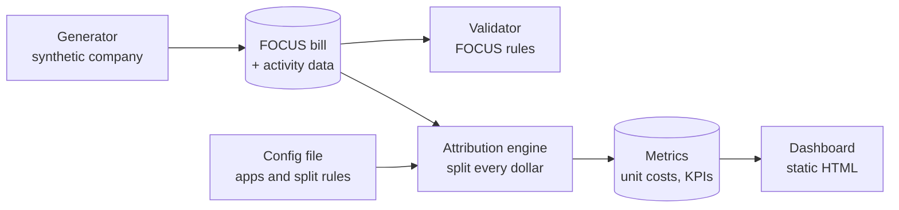
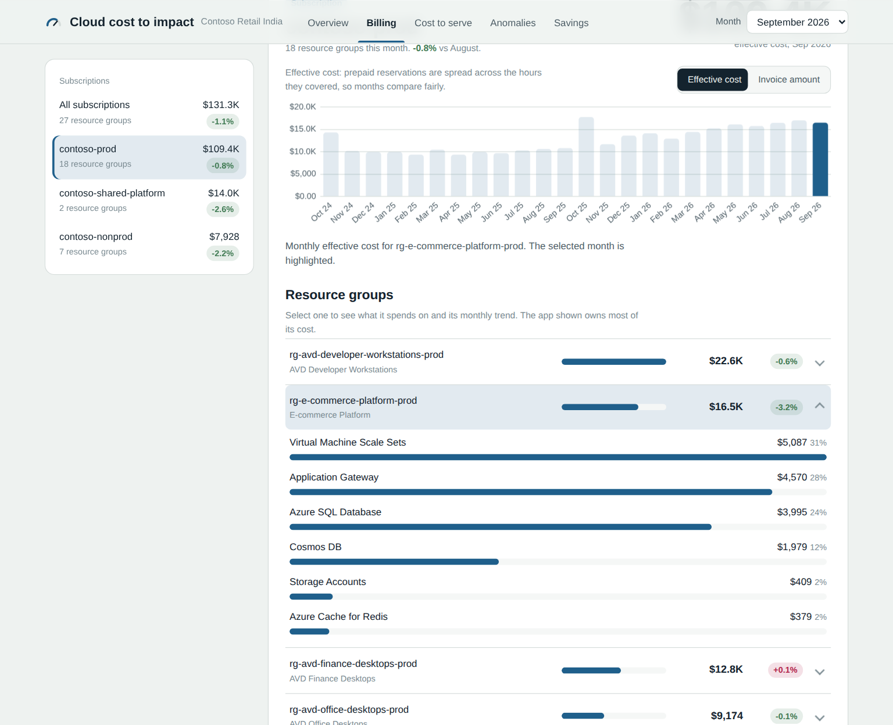
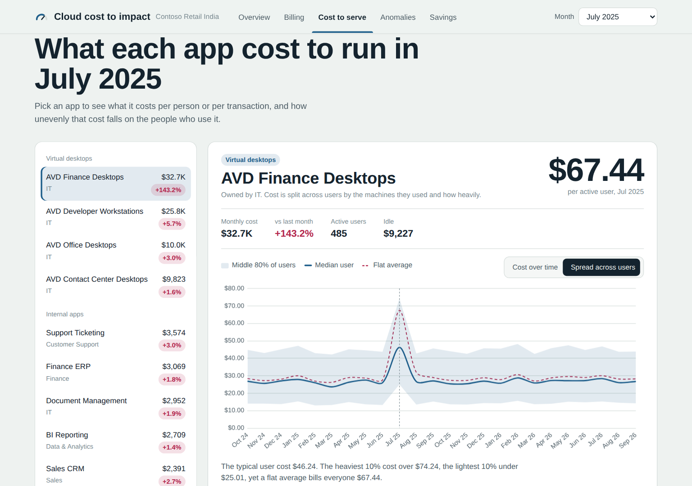
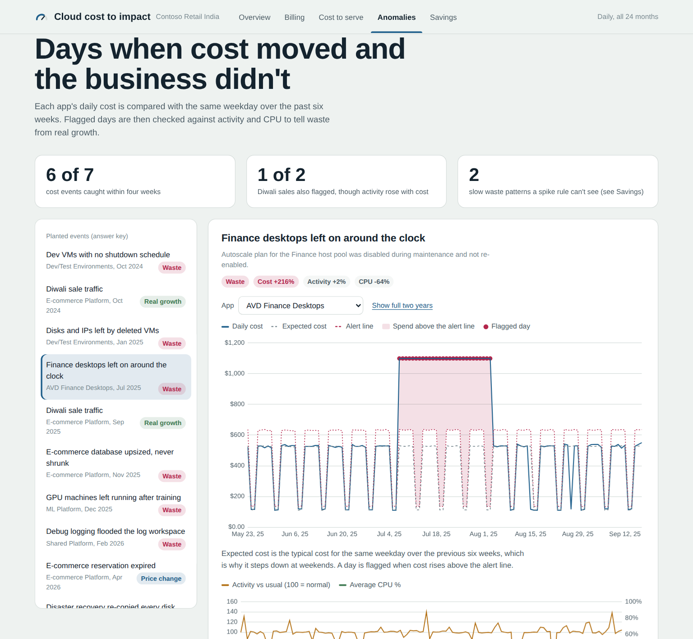
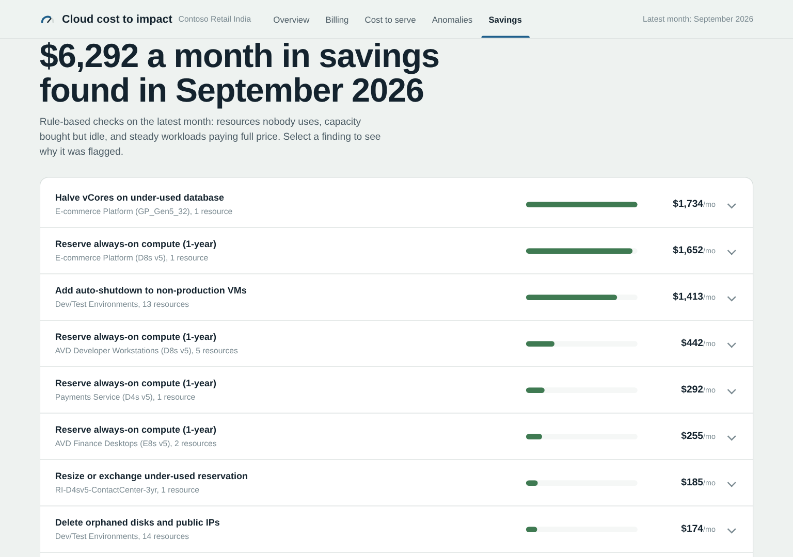

# Cloud Cost to User & Product Impact Analyzer

**A cloud bill tells you how much you spent. This tool tells you who spent it, what it produced, and whether it was worth it.**

It traces every dollar of an Azure bill (in the industry-standard FOCUS format) to the apps, teams, users and orders behind it, flags days when cost moved without the business moving, and ranks concrete savings.


### [View the live dashboard](https://mariyum008.github.io/Cloud-Cost-to-User-Product-Impact-Analyzer/)



## The problem

Most cloud cost dashboards stop at "we spent $131K this month, mostly on compute." That doesn't answer the questions that matter to a business:

- **Who** drove the cost: which team, which app, which users?
- **What did it produce:** how much does one order, or one employee's desktop, cost to run?
- **Was it worth it:** is cost growing faster than the business, and how much paid for nothing?

This project answers them by joining the cloud bill to activity data, and splitting every dollar with transparent, written rules.

## Key findings

Run on a synthetic company of 5,000 employees and 20 applications over 24 months ($2.98M of Azure spend):

| Finding | What the tool showed |
|---|---|
| A broken autoscaling setting | Finance desktop cost per user jumped from **$27.61 to $67.44** in one month, with **28% of it idle hosts** nobody used. The total bill barely hinted at it. |
| Efficiency slipping | E-commerce cost per 1,000 orders rose **30%** ($10.42 to $13.52) while order volume grew, from an unreverted database resize and an expired reservation. |
| Uneven usage | The typical Finance desktop user costs about **$27 a month**, but the heaviest 10% cost over **$45**. A flat average hides this. |
| Savings found | **$6,292 a month** ($75.5K a year) from nine rule-based findings: oversized databases, missing reservations, dev VMs without shutdown schedules, orphaned disks. |
| Works from the bill alone | Given only the raw FOCUS export, it mapped **96% of cost** to apps through tags and still detected the planted incidents. |

All data is synthetic, generated with known planted events, so every finding can be checked against an answer key.

## How it works



1. **Generator:** simulates a company day by day. Employees log in, customers place orders, computers are sized from that activity, and the Azure bill is calculated from the computers, in Microsoft's FOCUS export format. Problems are planted on purpose, with an answer key.
2. **Attribution engine:** maps each resource to an app, sorts each dollar into direct, shared or waste, splits shared platform cost across apps, then splits each app across its users by hours and CPU used. Four reconciliation checks prove every dollar lands exactly once.
3. **Dashboard:** a single self-contained HTML page (no server) with five views, published with GitHub Pages.

## Quick start

```bash
pip install -r requirements.txt
python -m generator                   # build the synthetic company (about 40s)
python validation/validate_focus.py   # check the bill against FOCUS 1.0 and Microsoft reference data
python -m attribution                 # split every dollar to apps, teams and users
python -m dashboard                   # build docs/index.html
open docs/index.html
```

Use `--seed 7` for a different company, or `--users 500 --months 6` for a fast test run.

## Use it on your own bill

The engine is driven by one config file, so it runs on any organization's FOCUS export (Azure, AWS or Google Cloud). Only the cost export is required; each extra input unlocks more analysis.

| Level | You provide | You get |
|---|---|---|
| 1 | A FOCUS cost export | Spend by app and team via tags, unused reservations, reservation candidates, unusual-cost episodes |
| 2 | + daily activity per app | Unit costs (per order, per request), cost vs business growth, telling waste from growth |
| 3 | + user sessions | Cost per user and per team, idle capacity, the spread of cost across users |

```bash
cp config/template.toml config/my-org.toml   # point it at your files and list your apps
python -m attribution --config config/my-org.toml
python -m dashboard --config config/my-org.toml --out docs/my-org.html
```

CSV templates for every input are in `templates/`. [`docs/bill-only.html`](docs/bill-only.html) shows what Level 1 looks like.

## The dashboard

| Page | Answers |
|---|---|
| **Overview** | What did the month cost, and is cost keeping pace with orders and headcount? |
| **Billing** | What did each subscription and resource group cost, as effective cost or as invoiced? |
| **Cost to serve** | What does each app cost per user or per 1,000 transactions, and how unevenly is that spread? |
| **Anomalies** | Which days did cost jump without activity moving, and was it waste or growth? |
| **Savings** | What should we do about it, ranked by monthly savings? |

<details>
<summary>Screenshots</summary>

**Billing:** subscriptions and resource groups, with what each spends on



**Cost to serve:** the Finance desktops during the autoscaling incident



**Anomalies:** cost against its expected range, with activity and CPU to separate waste from growth



**Savings:** ranked findings for the latest month



</details>

## Project structure

```
generator/      synthetic company: config.py (all settings), demand.py, infra.py, anomalies.py, focus.py
validation/     validate_focus.py: checks the bill against FOCUS 1.0 and Microsoft open data
config/         contoso.toml (synthetic company), example-bill-only.toml (level 1), template.toml (start here)
templates/      CSV templates for every optional input
attribution/    setup.py (config, inputs, mapping) and the engine runner with reconciliation
sql/            attribution/ (steps 10-50), metrics/ (KPI views), exploration queries
dashboard/      export script, queries, HTML template, vendored Chart.js
docs/           built dashboards, screenshots, and the technical reference
data/reference/ Microsoft FinOps toolkit open data
```

Full details on tables, inputs, allocation rules, the answer key and validation are in the **[technical reference](docs/reference.md)**.

## Tech stack

Python, NumPy and pandas for simulation; DuckDB and SQL for the attribution engine; Parquet for storage; FOCUS 1.0 with Microsoft's FinOps toolkit reference data; Chart.js with plain HTML, CSS and JavaScript for the dashboard; GitHub Pages for hosting.

## Roadmap

- [x] **Phase 1:** synthetic company with a causally linked Azure bill and a planted-event answer key
- [x] **Phase 2:** attribution engine with reconciliation, configurable for any organization
- [x] **Phase 3:** interactive dashboard
- [ ] **Phase 4:** machine learning anomaly detection, scored against the answer key
- [ ] **Phase 5:** cost forecasting
- [ ] **Phase 6:** recommendation engine
- [ ] **Phase 7:** upload wizard and direct cloud connectors

## Limitations

- The data is synthetic, and the planted events were designed alongside the detection, so results show the method works, not how it performs on every real estate.
- Prices are approximate Azure list prices, rounded.
- The anomaly rule (same weekday over six weeks) and savings checks are simple baselines; Phase 4 replaces them with stronger methods measured against the same answer key.

## Acknowledgments

Reference data from Microsoft's [FinOps toolkit](https://github.com/microsoft/finops-toolkit) (MIT). Charts by [Chart.js](https://www.chartjs.org/) (MIT). Cost data follows the [FOCUS specification](https://focus.finops.org/) from the FinOps Foundation.
